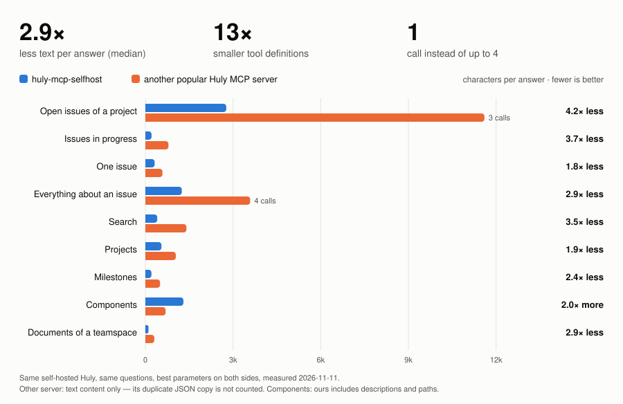

# huly-mcp-selfhost

[](https://www.npmjs.com/package/huly-mcp-selfhost)
[](https://github.com/JoKeks2023/huly-mcp/actions/workflows/ci.yml)
[](https://hub.docker.com/r/jokeks2023/huly-mcp)
[](https://registry.modelcontextprotocol.io)
[](https://github.com/JoKeks2023/huly-mcp/blob/main/LICENSE)

**Huly for AI agents.** An MCP server for [Huly](https://huly.io) — self-hosted or Huly Cloud — that lets Claude and other agents work in your workspaces: issues, epics, milestones, documents, chat, inbox, planner, test management and more. 224 tools, built for agent workflows and to spend as few tokens as possible.

[Website](https://jokeks2023.github.io/huly-mcp/) · [Quick start](#quick-start) · [Tools](#tools-224-total-grouped-in-toolsets) · [Claude Code plugin](#claude-code-plugin) · [Changelog](https://github.com/JoKeks2023/huly-mcp/blob/main/CHANGELOG.md)

## Highlights

- **Everything in Huly:** tracker, documents, chat, inbox, activity, planner, calendar, GitHub PRs, contacts, drive, cards, templates, test management, recruiting, CRM, HR and more — plus read access to *any* Huly class.
- **Made for agents:** one-call overviews (`my_day`, `standup`, `project_report`, `get_issue_context`), `start_work` → `finish_work`, plans → epics with sub-issues, specs and meeting notes → issues, claims for parallel agents, and `huly-mcp watch` to hand issues to Claude from Huly.
- **Few tokens:** tools come in toolsets (default ≈10k tokens, everything ≈23k), optionally loaded on demand; pin a workspace for −10 %; compact outputs; wrong parameters are rejected with the valid list instead of silently ignored.
- **Safe by default:** every change names its workspace, risky tools ask first, writes can be limited to projects, optional audit log.
- **Claude Code plugin:** `/huly:setup` asks once per repo how Huly is used there and writes the rules; skill, hooks and `/huly:*` commands. Guides and a `setup` prompt for every other MCP client too.
- **Self-hosted first:** document and description content, file uploads and internal URLs work on `huly-selfhost`; one account, all its workspaces.

## Tokens, measured

What the model reads — measured on a real self-hosted project (≈60 issues):

| | Characters | ≈ Tokens |
|---|--:|--:|
| Tool list, default toolsets (96 tools, each callable directly) | 36,527 | 10.4k |
| Tool list, pinned workspace | 32,962 | 9.4k |
| Open issues of a project (one call, ≈30 issues) | 2,768 | 0.8k |
| One issue with description | 318 | 0.1k |
| Project report (done, in progress, blocked, milestones, PRs, time) | ~2,700 | 0.8k |
| My day (calendar, to-dos, my issues, PRs, inbox) | ~1,200 | 0.3k |

Lists default to open items, empty fields are left out, and one call answers what would otherwise take four or five. Per call and question: [`costs.md`](https://github.com/JoKeks2023/huly-mcp/blob/main/plugin/skills/huly/costs.md).

### Compared with another popular Huly MCP server

<picture>
  <source media="(prefers-color-scheme: dark)" srcset="https://raw.githubusercontent.com/JoKeks2023/huly-mcp/main/docs/assets/benchmark-dark.svg">
  
</picture>

Same self-hosted Huly, same questions, the best parameters on both sides, measured 2026-11-11. For the other server only the text content is counted, not the duplicate JSON copy it also returns. Where we return more (components), it is because we include each component's description and code paths.

<details>
<summary>All numbers (characters)</summary>

| Question | huly-mcp-selfhost | Other server | Ratio |
|---|--:|--:|--:|
| Open issues of a project | 2,768 (1 call) | 11,601 (3 calls) | 4.2× less |
| Issues in progress | 211 (1 call) | 790 (1 call) | 3.7× less |
| One issue | 318 (1 call) | 585 (1 call) | 1.8× less |
| Everything about an issue (fields, sub-issues, comments, relations) | 1,246 (1 call) | 3,585 (4 calls) | 2.9× less |
| Search | 406 (1 call) | 1,405 (1 call) | 3.5× less |
| Projects | 550 (1 call) | 1,041 (1 call) | 1.9× less |
| Milestones | 208 (1 call) | 503 (1 call) | 2.4× less |
| Components | 1,302 (1 call) | 692 (1 call) | 2.0× more |
| Documents of a teamspace | 106 (1 call) | 305 (1 call) | 2.9× less |
| Tool definitions (49 tools with the same name) | 15,728 | 216,890 | 13.8× less |

</details>

## Quick start

You need Node.js 20+ and a Huly account — [Huly Cloud](https://huly.app) or self-hosted.

**Claude Code** — install the plugin, then fill in its settings when asked:

```
/plugin marketplace add JoKeks2023/huly-mcp
/plugin install huly@huly-mcp
```

Then run `/huly:setup` in a repository. Details: [Claude Code plugin](#claude-code-plugin).

**Claude Desktop, Cursor, VS Code, Windsurf, Zed, …** — add the server to your client's MCP config:

```json
{
  "mcpServers": {
    "huly": {
      "command": "npx",
      "args": ["-y", "huly-mcp-selfhost"],
      "env": {
        "HULY_EMAIL": "you@example.com",
        "HULY_PASSWORD": "your-password"
      }
    }
  }
}
```

- **Self-hosted Huly:** add `"HULY_ACCOUNTS_URL": "https://huly.example.com/_accounts"` and `"HULY_FRONT_URL": "https://huly.example.com"`.
- **Google/GitHub login (no password):** run `npx huly-mcp-selfhost setup` and use `HULY_TOKEN` instead — see [Authentication](#authentication).
- **One workspace?** Add `"HULY_WORKSPACE": "<slug>"` — fewer tokens.

Config file locations and examples for each client: [Compatible clients](#compatible-clients).

**Server for a team or remote clients** — run the Docker image (HTTP/SSE on port 8000): see [Docker](#docker).

Then ask: *"What's on my plate today?"*, *"Plan the login redesign as an epic in WEB"*, *"Write release notes for v1.2"*. More in [Example prompts](#example-prompts).

---

## Claude Code plugin

The repo is also a Claude Code plugin marketplace. The plugin bundles the MCP server with a workflow skill, hooks and commands:

```
/plugin marketplace add JoKeks2023/huly-mcp
/plugin install huly@huly-mcp
```

> **Note:** the plugin starts the npm package at exactly its own version (e.g. `huly-mcp-selfhost@3.3.1`; the plugin directory does not accept version ranges), so a plugin update brings the matching server. To try a local checkout instead: `npm run build`, then point `plugin/.mcp.json` at `dist/index.js` and start `claude --plugin-dir ./plugin`.

Claude Code then asks for your Huly settings (e-mail + password or token, and for self-hosted Huly the accounts and front URL; passwords and tokens go to the OS keychain).

| Part | What it does |
|------|--------------|
| MCP server | `huly-mcp-selfhost` via `npx`, configured from the plugin settings (toolsets, on-demand loading, pinned workspace and writable projects included); tool annotations on (`HULY_ANNOTATIONS=1`) |
| Skill `huly` | How to use Huly while coding at the lowest token cost: the repo's `## Huly` rules first, find the project for the repo, pick up/hand back issues, status flow, duplicate check, component + milestone, epics for plans, cheapest call per question. Reference files are read only when needed: `costs.md` (measured output size per call), `onboarding.md` (bringing a project into Huly) and `features.md` (all of Huly for a software project — labels, templates, test management incl. CI import, documents, drive, custom fields, cards — with the toolsets each needs) |
| Hook on session start | Reports the GitHub repo and branch; a branch like `proj-12-login` points Claude to issue `PROJ-12`; points to the repo's `## Huly` rules or offers `/huly:setup` (no network, no credentials) |
| Hook after `gh pr create` / `gh pr merge` | Reminds Claude to link the new PR to its issue (`finish_work`) or to check the status after a merge |
| `/huly:setup [workspace]` | Set up Huly for this repo: asks how Huly is used here (role, where new issues go, initiative, how token-saving), writes the answers as a `## Huly` section to `CLAUDE.md`, `CLAUDE.local.md` (only you) or split between both, then optionally imports the project (status set, components, milestones, TODO/FIXME proposals, architecture document). The session-start hook offers it once while a repo has no such section |
| `/huly:start [PROJ-12]` | Pick up an issue (from the argument or the branch), load the context, plan |
| `/huly:finish [PROJ-12] [PR]` | Honest summary, PR link, status to review |
| `/huly:plan <goal>` | Plan → epic + sub-issues (dry run first) |
| `/huly:day`, `/huly:standup [since]`, `/huly:triage` | My day, stand-up, inbox triage — one call each (`my_day`, `standup`, `triage_inbox`) |
| `/huly:report <PROJECT> [7d]` | Project status: progress, milestones, blockers (`project_report`) |

Without the plugin, the same server works in Claude Code as a plain MCP server (see below); the MCP prompts (`setup`, `start`, `finish`, `plan`, `triage`, `standup`) and guide resources are available there too.

---

## Tools (224 total, grouped in toolsets)

All tools except `list_workspaces` take a `workspace` argument — required for every change, optional for reads when only one workspace is available.

### Toolsets

Every tool schema is sent to the model in each session (Claude Desktop loads all of them up front), so tools are grouped and only the default toolsets are enabled unless you choose otherwise:

```bash
HULY_TOOLSETS=all                       # everything
HULY_TOOLSETS=tracker,documents,planner # just these ('core' = list_workspaces is always on)
```

**Load on demand** (`HULY_DYNAMIC_TOOLSETS=1`): `HULY_TOOLSETS` becomes the starting set, and Claude loads more toolsets itself via `enable_toolsets`. Called without arguments, it lists every toolset with its tools; called with names, it loads them and tells the client that the tool list changed. With `HULY_TOOLSETS=agent,inbox` a session starts at ≈1.8k tokens instead of ≈9–11k. This needs a client that reloads the tool list on `notifications/tools/list_changed`: it is tested with the MCP SDK client, but **not yet verified in Claude Desktop**. Without the variable, nothing changes.

| Toolset | Default | Tools | Contents |
|---------|:-:|--:|----------|
| `agent` | ✓ | 14 | agent workflow: my day at a glance, standup, project report, release notes, issue context in one call, start/finish work, plan → issue tree, spec document → issues, meeting notes → issues, changes since, claims, repo → project — plus [resources and prompts](#agent-workflow) |
| `tracker` | ✓ | 37 | projects, issues, comments, time, labels, relations, milestones, components, statuses, attachments, search |
| `documents` | ✓ | 8 | teamspaces and documents (tree, move, rename) |
| `chat` | ✓ | 12 | channels, DMs, threads, edit/delete, reactions, pins |
| `contacts` | ✓ | 11 | members, organizations, persons, contact channels |
| `inbox` | ✓ | 3 | notifications, triage (what changed since last read), mark read/archive |
| `activity` | ✓ | 1 | change history of an issue/object |
| `planner` | ✓ | 5 | to-dos, time blocking |
| `generic` | ✓ | 4 | fulltext search across everything, read any Huly class |
| `tracker-admin` | | 12 | rarely needed admin: create/update project, create status, update/delete label, label categories, delete milestone/component, repair parent links, project types and workflows |
| `calendar` | | 4 | calendar events |
| `github` | | 2 | pull requests synced by Huly's GitHub integration (read-only) |
| `generic-write` | | 3 | create/update/delete any class — dry run by default, deletes need `confirm` |
| `collaboration` | | 8 | followers (collaborators) of issues/documents, public guest links, document comments |
| `cards` | | 8 | cards: types and tags, create/edit/move/delete, nesting, field values |
| `fields` | | 3 | custom fields on issues, project types, card types or any class; set values |
| `drive` | | 10 | drives, folders, versioned files: upload, download, move, restore versions |
| `templates` | | 11 | issue templates with sub-issues, new issue from template; message templates |
| `testing` | | 23 | test management: projects, suites, cases, plans, runs, results; JUnit import, report, bugs from failed tests |
| `products` | | 2 | products and versions (read-only) |
| `members` | | 4 | workspace settings, invite links and e-mails, member roles |
| `recruiting` | | 9 | vacancies, candidates, applications |
| `crm` | | 5 | leads, customers |
| `hr` | | 7 | departments, staff, vacation/sick/remote days |
| `inventory` | | 5 | categories, products, variants (SKU) |
| `meetings` | | 2 | office rooms, meeting minutes and transcripts (read-only) |
| `qms` | | 4 | controlled documents and trainings (read-only) |
| `process` | | 4 | process definitions and executions; start and cancel |
| `surveys` | | 2 | surveys and aggregated poll answers (read-only) |

Context cost of `tools/list` (≈3.5 chars/token):

| | default (96 tools) | `all` (224 tools) |
|---|--:|--:|
| several workspaces | ~36.5k chars ≈ **10.4k tokens** | ~81.6k chars ≈ **23.3k tokens** |
| pinned with `HULY_WORKSPACE` | ~33k chars ≈ **9.4k tokens** | ~73.3k chars ≈ **20.9k tokens** |

For comparison, 2.2.0 needed ≈12.8k tokens for 64 tools. **Using one workspace? Set `HULY_WORKSPACE`** — the `workspace` argument then disappears from every tool (−10%). **Claude Code** loads MCP tools on demand, so there even `HULY_TOOLSETS=all` costs little up front.

### Agent workflow

Tools, resources and prompts for AI agents working on Huly issues (toolset `agent`):

| Tool | What it does |
|------|--------------|
| `my_day` | Today (or `date`) in one call: own calendar events and work slots, open to-dos (overdue and due first), open issues assigned to me (in progress first), PRs waiting for my review and my own open PRs, unread inbox grouped by object. Times in UTC |
| `standup` | What I did since the last working day (Monday → Friday, or `since`): status changes, new issues, comments, time, finished to-dos; then today (calendar, to-dos, my issues) and my issues blocked by open ones |
| `release_notes` | Release notes from a milestone: done issues as "New and changed" and "Fixes" (by title or label, English and German), merged PR numbers, epics left out; open issues listed separately |
| `project_report` | Weekly (or `since`: `14d`, ISO date) report of a project: done in the period (status changed to done — not just touched by sync), new, in progress (flagged when untouched), blocked by open issues, overdue, PRs merged and open, open milestones with progress and target, time logged per person. To keep it in Huly, pass the text to `create_document` + `update_document` |
| `get_issue_context` | Everything about an issue in one call: fields, description, parent chain, sub-issues, blocked by / blocks, related, PRs, comments, suggested branch name |
| `start_work` | Status → In Progress, assign to me, optionally claim — returns the full context |
| `finish_work` | Work summary as comment, PR (`#12`, URL or Huly id) linked as sub-issue, status → Review in progress, claim released. Validates the PR before changing anything |
| `create_issue_tree` | Plan → epic + sub-issues with priorities, components, milestones, assignees, labels and blockers (`"#2"` = second child). Same-title issues are reused, dry run by default |
| `issues_from_document` | Spec → issues: the open checklist items of a Huly document (without a checklist: its sections) become sub-issues of an epic, checked items are skipped, the document is linked to the epic. Dry run by default; one call instead of reading the document and repeating every task |
| `issues_from_meeting` | Meeting notes → issues: open checkboxes, lines starting with `TODO:`/`Action:`/`Aufgabe:` and list items under a heading like "Action items" or "Next steps" become issues. `@Name` (or a Huly mention) becomes the assignee, a date (`2026-11-10`, `10.11.2026`, "due …"/"bis …") the due date. Unknown people are flagged and left unassigned; same-title issues are skipped; each new issue is linked to the document. Dry run by default |
| `changes_since` | Issues/PRs changed since `24h`, `7d` or an ISO time — which fields changed, new comments, by whom |
| `find_project_for_repo` | Workspace + project linked to a GitHub repo (`owner/name`, URL or git remote) via Huly's GitHub integration |
| `claim_issue` / `release_issue` | Lease an issue to an agent (label `agent:working` + comment marker) so parallel agents skip it; expires after `minutes` |

**Resources** — `huly://<workspace>/issue/<PROJ-12>` and `huly://<workspace>/document/<id>`. Your open assigned issues are listed, so in Claude Code you can `@`-mention them. Guides for agents in any client: `huly://guide/workflow` (how to work with Huly), `huly://guide/costs` (cheapest call per question) and `huly://guide/onboarding` (bringing a project into Huly) and `huly://guide/features` (which Huly feature to use for what, and which toolset it needs) — the same text as the plugin skill.

**Prompts** — `setup` (ask how Huly is used for a project and write the rules for your project instructions), `start`, `finish`, `plan`, `triage`, `standup` (in Claude Code: `/mcp__huly__start` …).

**Guard rails** (environment):

| Variable | Effect |
|----------|--------|
| `HULY_WRITE_PROJECTS=TSK,WEB` | Changes are only allowed when every project they touch (project keys and `PROJ-12` ids in the arguments) is listed. Reads are never blocked. Tools without a project (chat, documents, planner) are not affected |
| `HULY_AUDIT_LOG=/path/audit.jsonl` | Every change is appended as one JSON line (time, tool, shortened arguments, success, first line of the result) |
| `HULY_AGENT_NAME=claude-2` | Default agent name for claims |
| `HULY_CONFIRM=auto` | Deletes and other hard-to-undo tools (`delete_*`, `bulk_update_issues`, `move_issue`, `generic_update`/`generic_delete`, `revoke_public_link`, `restore_file_version`) ask you first via MCP elicitation when the client can show a form (Claude Code in an interactive session). `auto` (default): ask when possible, otherwise run as before. `strict`: refuse when the client cannot ask (unattended agents). `off`: never ask. Dry runs never ask |

### Huly hands work to Claude: `huly-mcp watch`

`huly-mcp watch` turns Huly into the place where you give Claude work. It polls for open issues that carry a label (`--label claude`) or are assigned to the account it runs as (`--assigned`, the default), and for each one:

1. claims the issue (`claim_issue`), so a second watcher or agent skips it,
2. runs a command for it — by default `claude -p` in the current directory, with this MCP server attached and a prompt that says: read the issue, do the work, hand back with `finish_work`,
3. releases the claim if the run did not (`finish_work` releases it), and comments on the issue if the run failed or timed out.

```bash
cd ~/code/my-repo
npx huly-mcp-selfhost watch --workspace acme --project WEB --label claude --dry-run   # what would run
npx huly-mcp-selfhost watch --workspace acme --project WEB --label claude             # poll every 60 s
```

- **Each issue runs once.** A state file (`~/.huly-mcp/watch-<workspace>.json`) remembers it. To run it again, remove the label and add it again.
- **The command is yours.** `--command` takes any program; the placeholders `{prompt}` `{issue}` `{title}` `{workspace}` `{agent}` `{trigger}` `{mcpConfig}` are filled in per argument — no shell is involved, so issue titles cannot inject shell commands. The run also gets `HULY_ISSUE`, `HULY_ISSUE_TITLE` and `HULY_WORKSPACE` in its environment. Examples: a GitHub Action (`--command "gh workflow run agent.yml -f issue={issue}"`), or Claude with more tools (`--command "claude -p {prompt} --mcp-config {mcpConfig} --allowedTools mcp__huly,Bash(npm test),Edit"`).
- **Default command:** `claude -p {prompt} --mcp-config {mcpConfig} --strict-mcp-config --allowedTools mcp__huly --permission-mode acceptEdits`. `{mcpConfig}` is a temporary MCP config that starts this server limited to the watched workspace; the credentials are passed through the environment, not written to the file.
- **Unattended means careful.** Runs get `HULY_CONFIRM=strict` unless you set it: deletes and other risky tools are refused, because nobody is there to confirm them. `HULY_WRITE_PROJECTS` limits which projects are watched and changed. Issue text reaches the agent as instructions — only watch projects whose writers you trust.
- **Its own identity.** Give the agent its own Huly account (invite e.g. `claude@your-domain` to the workspace) and start the watcher with that account's credentials (`--env-file agent.env` with `HULY_EMAIL`/`HULY_PASSWORD` or `HULY_TOKEN`). Then you hand work to Claude by assigning an issue to that user, and every comment, status change and claim shows up under its name instead of yours. `--agent <name>` (or `HULY_AGENT_NAME`) names it in claims.
- Other options: `--interval <sec>`, `--timeout <min>` (default 60), `--once`, `--cwd <dir>`, `--prompt <template>`, `--state <file>`. `huly-mcp watch --help` lists them all.

### CI test results into Huly: `huly-mcp junit`

`huly-mcp junit report.xml --project "App"` imports a JUnit XML report as a test run in Huly's test management. Almost every test runner writes JUnit XML (Jest/Vitest with a JUnit reporter, `pytest --junitxml`, `go-junit-report`, Gradle, Maven Surefire, xcpretty). Suites and cases that do not exist yet are created; failed tests keep their message and stack trace. Then ask Claude *"What is flaky in App?"* (`get_test_report`) or *"File bugs for today's failures in PROJ"* (`create_issue_from_test_result`).

```yaml
# .github/workflows/test.yml (after the test step)
- name: Report to Huly
  if: always()
  run: npx -y huly-mcp-selfhost junit reports/junit.xml --project "App" --run "CI ${{ github.ref_name }} #${{ github.run_number }}"
  env:
    HULY_URL: ${{ secrets.HULY_URL }}
    HULY_TOKEN: ${{ secrets.HULY_TOKEN }}
    HULY_WORKSPACE: my-workspace
```

Options: `--run <name>`, `--parent-suite <suite>`, `--no-create` (only existing cases), `--fail-on-failures` (exit code 1 when tests failed), `--dry-run`, `--workspace`. `huly-mcp junit --help` lists them.

### Tool reference

| Category | Tool | Description |
|----------|------|-------------|
| **Workspaces** | `list_workspaces` | List the workspaces this account can access (name, slug, id) |
| **Projects** | `list_projects` | List all projects in a workspace |
| | `get_project` | Get project details + available statuses |
| | `create_project` | Create a new tracker project with a unique identifier *(tracker-admin)* |
| | `update_project` | Change name, description, default assignee or default status *(tracker-admin)* |
| **Issues** | `list_issues` | List issues — open ones by default (`status: "all"` or a status name for others), filterable by priority, milestone, component, label, assignee, parent (`null` = none for each), text in the title and due date (`overdue`, `set`, `none`); `offset` pages through long lists ("51–100 of 118") |
| | `get_issue` | Full details of an issue (e.g. `PROJ-42`): assignee, milestone, component, labels, parent, links |
| | `create_issue` | Create a new issue (with optional Markdown description) |
| | `update_issue` | Update title, description, status, priority, assignee, due date, component, milestone |
| | `delete_issue` | Permanently delete an issue by identifier |
| | `bulk_update_issues` | Same change on many issues at once — validates all before writing |
| | `move_issue` | Move an issue (with sub-issues, comments, attachments, labels, time) to another project |
| | `list_sub_issues` | Sub-issue tree of an epic with status and progress |
| **Comments** | `add_comment` | Add a comment to an issue |
| | `list_comments` | Newest comments on an issue, oldest first (includes IDs for `delete_comment`); comments over 1,500 chars are shortened with a marker unless `full: true` |
| | `update_comment` | Edit a comment |
| | `delete_comment` | Delete a specific comment by ID |
| **Time Tracking** | `log_time` | Log hours spent on an issue |
| | `list_time_reports` | Logged time per issue or project, totals per member, member/date filters |
| **Labels** | `list_labels` | List all labels with color + usage count |
| | `create_label` | Create a new label with an optional hex color |
| | `add_label` | Add a label to an issue (auto-creates if it doesn't exist) |
| | `remove_label` | Remove a label from an issue |
| | `update_label` | Rename or recolor a label (updated on every issue) *(tracker-admin)* |
| | `delete_label` | Delete a label and remove it from every issue *(tracker-admin)* |
| **Relations** | `add_relation` | Mark two issues as related (bidirectional) |
| | `add_blocked_by` | Mark an issue as blocked by another issue |
| | `set_parent` | Set or clear the parent epic of an issue |
| | `remove_relation` | Remove a "related" link |
| | `remove_blocked_by` | Remove a "blocked by" link |
| | `repair_parent_links` | Fix sub-issues linked by huly-mcp ≤ 2.1 that don't show under their parent (dry run by default) *(tracker-admin)* |
| **Members** | `list_members` | List workspace members with names and roles |
| **Persons** (`contacts`) | `list_persons` | Contact persons with their channels |
| | `get_person` | Person details, contact channels, organizations |
| | `create_person` | Create a contact person (with optional channels) |
| | `update_person` | Change name or city |
| | `add_contact_channel` | Add email, phone, LinkedIn, … |
| | `remove_contact_channel` | Remove a contact channel |
| **Milestones** | `list_milestones` | List milestones for a project |
| | `create_milestone` | Create a milestone with a target date and status |
| | `get_milestone` | Milestone details with progress (done/open/canceled issues) and the open issues |
| | `update_milestone` | Change name, target date, status or description |
| | `delete_milestone` | Delete a milestone; its issues are unassigned or moved (`moveIssuesTo`) *(tracker-admin)* |
| **Components** | `list_components` | List components (sub-areas) in a project |
| | `create_component` | Create a new component with optional lead |
| | `update_component` | Change name, description or lead |
| | `delete_component` | Delete a component; its issues are unassigned or moved (`moveIssuesTo`) *(tracker-admin)* |
| **Documents** | `list_teamspaces` | List document teamspaces |
| | `create_teamspace` | Create a new teamspace (top-level document folder) |
| | `list_documents` | List documents in a teamspace |
| | `delete_document` | Permanently delete a document by ID |
| | `get_document` | Get document metadata + content |
| | `create_document` | Create a new document in a teamspace |
| | `update_document` | Write Markdown content to a document — Mermaid diagrams render natively |
| | `link_document` | Link a document to an issue — appears in the Relations panel |
| | `list_documents` | Shows the full document tree; `update_document` also renames and moves (incl. to another teamspace, with sub-documents) |
| **Search** | `search_issues` | Full-text search across all issues of a workspace |
| | `search` | Full-text search across everything — issues, documents, messages, cards, files, persons … (`kinds` filter) *(generic)* |
| **Chat** | `list_channels` | List all channels in the workspace |
| | `create_channel` | Create a new channel |
| | `start_direct_message` | Start (or find) a 1:1 direct message with a workspace member |
| | `send_message` | Send a message to a channel or direct message |
| | `list_messages` | List messages with authors, ids, replies, reactions, pins |
| | `list_thread` | A message with its thread replies |
| | `reply_to_message` | Reply in a thread (channel messages and issue comments) |
| | `update_message` | Edit a message or reply |
| | `delete_message` | Delete a message or reply |
| | `add_reaction` / `remove_reaction` | Emoji reactions |
| | `pin_message` | Pin or unpin a message |
| **Attachments** | `attach_file` | Attach a file to an issue (base64-encoded content) |
| | `list_attachments` | List files attached to an issue |
| | `delete_attachment` | Delete a file attachment from an issue |
| **Issue Statuses** | `list_issue_statuses` | List all issue statuses (workflow states), grouped by phase |
| | `create_issue_status` | Create a new issue status — available in every project immediately *(tracker-admin)* |
| **Organizations** | `list_organizations` | List all organizations (companies) in the workspace |
| | `get_organization` | Get details of an organization, including description |
| | `create_organization` | Create a new organization (company contact) |
| | `update_organization` | Set the description of an organization from Markdown |
| **Inbox** (`inbox`) | `list_notifications` | Your notifications, grouped by issue/PR/document |
| | `triage_inbox` | Work through the inbox in one call: per unread item its status and assignee, which fields changed and the new comments (plain text, shortened) since you last read it |
| | `mark_notifications_read` | Mark read by object, ids or all; optionally archive |
| **Activity** (`activity`) | `get_activity` | Who changed what, plus comments, for an issue or object |
| **Planner** (`planner`) | `list_todos` | Your to-dos (open/done, due date filter) |
| | `create_todo` | Create a to-do, optionally attached to an issue |
| | `update_todo` | Change title, due date, priority; mark done/reopen |
| | `delete_todo` | Delete a to-do |
| | `schedule_todo` | Block time for a to-do in your calendar |
| **Calendar** (`calendar`) | `list_events` | Events and work slots in a date range |
| | `create_event` / `update_event` / `delete_event` | Manage events in your calendar |
| **GitHub** (`github`) | `list_pull_requests` | PRs by project, issue, state |
| | `get_pull_request` | State, branches, reviews, review comments, linked issue |
| **Generic** (`generic`) | `list_classes` | All data classes of the workspace (filter by module, optional counts) |
| | `describe_class` | Attributes and types of a class |
| | `query_documents` | Read documents of any class; secrets are redacted |
| **Generic write** (`generic-write`) | `generic_create` / `generic_update` / `generic_delete` | Any class; dry run by default, deletes also need `confirm: true`; system classes, spaces and credentials are blocked |
| **Collaboration** (`collaboration`) | `list_collaborators` / `add_collaborator` / `remove_collaborator` | Who follows an issue/document (and gets its notifications) |
| | `create_public_link` / `list_public_links` / `revoke_public_link` | Read-only guest links for issues and documents |
| | `list_document_comments` / `add_document_comment` | Comments on documents |
| **Cards** (`cards`) | `list_card_types` / `create_card_type` / `delete_card_type` | Card types (MasterTags) and tags |
| | `list_cards` / `get_card` | Cards by type, parent or title; one card with fields, tags, children, content |
| | `create_card` / `update_card` / `delete_card` | With content (Markdown), parent, tags and field values |
| **Custom fields** (`fields`) | `list_custom_fields` | Fields of issues, a project type, card type or class — or the values on one object |
| | `create_custom_field` | string, number, boolean, date, markup, enum (with values) or ref |
| | `set_custom_fields` | Set values on an issue, card or document (validated against the type) |
| **Drive** (`drive`) | `list_drives` / `create_drive` / `list_drive_files` | Drives and their folder tree |
| | `create_folder` / `update_drive_item` / `delete_drive_item` | Folders; rename/move files and folders (across drives too) |
| | `upload_file` / `download_file` | Base64 or local files under `HULY_FILE_ROOT`; same name → new version |
| | `list_file_versions` / `restore_file_version` | File history |
| **Issue templates** (`templates`) | `list_issue_templates` / `get_issue_template` | Templates with their sub-issues |
| | `create_issue_template` / `update_issue_template` / `delete_issue_template` | Priority, assignee, component, milestone, estimation, labels, sub-issues |
| | `create_issue_from_template` | New issue plus sub-issues from a template |
| **Test management** (`testing`) | `list_test_projects` / `create_test_project` | Test projects |
| | `list_test_cases` / `create_test_suite` / `get_test_case` / `create_test_case` / `update_test_case` / `delete_test_case` | Suites (nested) and cases |
| | `list_test_plans` / `create_test_plan` | Plans from suites and/or cases |
| | `create_test_run` / `list_test_runs` / `get_test_run` / `set_test_result` | Runs with Passed/Failed/Blocked results; results can be assigned |
| | `create_test_cases` | Many cases in one call (e.g. drafted from a spec or an issue); existing names are skipped |
| | `update_test_suite` / `delete_test_suite` / `update_test_run` / `delete_test_run` / `delete_test_plan` | Rename/move suites (no cycles), delete with `recursive`, run due dates |
| | `import_test_results` | JUnit XML from CI (Jest, Vitest, pytest, Go, Gradle, Maven, xcpretty …) as a run; missing suites/cases are created, failures keep message and stack trace |
| | `get_test_report` | Over the latest runs: failing now, flaky (flipped ≥ 2×), blocked, never run, per-suite table |
| | `create_issue_from_test_result` | Bug from a failed result: steps + failure in the description, related to the test case, comment on the result |
| **Products** (`products`) | `list_products` / `get_product` | Products and their versions (read-only) |
| **Labels** (`tracker-admin`) | `list_label_categories` / `create_label_category` / `set_label_category` | Group issue labels |
| **Project types** (`tracker-admin`) | `list_project_types` | Project types, their task types and status workflows, and which projects use them |
| **Workspace** (`members`) | `get_workspace_settings` | Your role, members per role, invite defaults, integrations |
| | `create_invite_link` / `send_invite` / `set_member_role` | Invite links (personal or with use limit and e-mail mask; nothing is sent), invitation e-mails, roles. `send_invite` and `set_member_role` ask for confirmation |
| **Recruiting** (`recruiting`) | `list_vacancies` / `create_vacancy` / `update_vacancy` | Vacancies with applications per status; archive via `update_vacancy` |
| | `list_candidates` / `create_candidate` | Candidates (person + title, e-mail, onsite/remote) |
| | `list_applications` / `create_application` / `update_application` / `delete_application` | Applications `APP-n` through the vacancy's workflow, one per candidate and vacancy |
| **CRM** (`crm`) | `list_leads` / `create_lead` / `update_lead` / `delete_lead` / `list_customers` | Leads `LEAD-n` in funnels; a new customer (person or organization) can be created with the lead |
| **HR** (`hr`) | `list_departments` / `create_department` / `delete_department` / `set_department` | Department tree, team leads, members |
| | `list_time_off` / `create_time_off` / `delete_time_off` | Vacation, sick days, PTO, overtime, remote days |
| **Inventory** (`inventory`) | `list_inventory` / `create_inventory_category` / `create_inventory_product` / `update_inventory_item` / `delete_inventory_item` | Categories, products, variants with SKU (Huly beta module) |
| **Message templates** (`templates`) | `list_message_templates` / `get_message_template` / `create_message_template` / `update_message_template` / `delete_message_template` | Reusable texts with `${field}` placeholders |
| **Meetings** (`meetings`) | `list_meetings` / `get_meeting` | Rooms, meeting minutes, action items and transcripts (read-only) |
| **QMS** (`qms`) | `list_controlled_documents` / `get_controlled_document` | Controlled documents: version, state, reviewers/approvers, requests, content (read-only) |
| | `list_trainings` / `get_training` | Trainings, questions (answers optional) and trainee results (read-only) |
| **Processes** (`process`) | `list_processes` / `list_executions` / `start_process` / `cancel_execution` | Process states and transitions; running executions; run a process on a card like Huly's "Run process" menu (processes that ask for input in the app are refused); cancel asks first |
| **Surveys** (`surveys`) | `list_surveys` / `get_survey` | Surveys and aggregated poll answers (read-only) |

---

## Workspaces (one account, several workspaces)

A single Huly account can belong to several workspaces — e.g. a personal one and a team one. This server logs in **once** with your account credentials and discovers every workspace that account can access via the account service (`getUserWorkspaces()`). You **don't configure a workspace** in the environment.

- **`list_workspaces`** returns name, slug and id of every available workspace.
- **Every other tool takes a `workspace` argument** — the slug, the name or the id (case-insensitive):
  `list_projects(workspace="jokeks2023")`, `get_issue(workspace="acme", identifier="PROJ-1")`, `log_time(workspace="jokeks2023", identifier="WEB-12", hours=2)`.
- **Changes always require `workspace`.** Every tool that creates, updates, deletes, links, sends, attaches or logs something has `workspace` as a required argument — the server never falls back to an implicit, default or "last used" workspace for a write.
- **Reads may omit `workspace` only if exactly one workspace is available.** With several, the call fails and lists the options.
- **IDs are per workspace.** `PROJ-1`, a document id or a comment id identifies something only together with its workspace — the same id can exist in two workspaces. Pass the same `workspace` you got the id from.
- Each workspace gets its own lazily opened, cached WebSocket connection with its own workspace token (via `selectWorkspace()`), so workspaces never share state.

**Workspace slug:** the part of the Huly URL after the domain: `huly.app/workbench/`**`myteam`** → `myteam`. You don't need to look it up — `list_workspaces` (or `npx huly-mcp-selfhost setup`) prints it.

**`HULY_WORKSPACE`:** pins the server to that one workspace. Tools then have no `workspace` argument at all, which saves ~10% of the tool-list tokens. Leave it unset to use all workspaces of the account.

---

## Configuration

| Variable | Required | Purpose |
|----------|----------|---------|
| `HULY_EMAIL` + `HULY_PASSWORD` | one auth option | Account login (needs a password set on your Huly account) |
| `HULY_TOKEN` | one auth option | Account token for SSO accounts (Google/GitHub) — get it with `npx huly-mcp-selfhost setup` |
| `HULY_ACCOUNTS_URL` | self-hosted only | Account service — login and workspace discovery. Default `https://account.huly.app`. Self-hosted: your instance's accounts URL, e.g. `https://huly.example.com/_accounts` |
| `HULY_FRONT_URL` | self-hosted (optional on Cloud) | Front service — document/description content and file uploads. Not involved in login or workspace discovery. Self-hosted: e.g. `https://huly.example.com` |
| `HULY_TRANSACTOR_URL` | no | Self-hosted, server next to Huly: connect to the transactor directly instead of the public address the account service returns, e.g. `ws://huly/_transactor` (via nginx) or `ws://transactor:3333`. Saves the detour through your uplink/tunnel. `HULY_ACCOUNTS_URL` can be internal too (`http://huly/_accounts`); an internal `HULY_FRONT_URL` also works but then invite links show the internal address |
| `HULY_WORKSPACE` | no | Pin the server to one workspace; tools then take no `workspace` argument (fewer tokens) |
| `HULY_ANNOTATIONS` | no | `1`: every tool carries MCP annotations — a title, `readOnlyHint` for reads, `destructiveHint` for deletes/removals/bulk changes. Clients can use them to allow reads without asking. Costs ~16% more tool-list tokens, so it is off by default; the Claude Code plugin turns it on |
| `HULY_DYNAMIC_TOOLSETS` | no | `1`: start with `HULY_TOOLSETS` and load more on demand via `enable_toolsets` (see [Toolsets](#toolsets)) |
| `HULY_TOOLSETS` | no | Comma-separated toolsets to enable, or `all` (see [Toolsets](#toolsets)). Default: `agent,tracker,documents,chat,contacts,inbox,activity,planner,generic` |
| `HULY_WRITE_PROJECTS` | no | Only allow changes in these projects, e.g. `TSK,WEB` (see [Agent workflow](#agent-workflow)) |
| `HULY_AUDIT_LOG` | no | Append every change as JSON line to this file |
| `HULY_AGENT_NAME` | no | Default agent name for `claim_issue` (default `claude`) |
| `HULY_CONFIRM` | no | `auto` (default), `strict` or `off` — ask before deletes and other risky tools (see [Agent workflow](#agent-workflow)) |
| `HULY_FILE_ROOT` | no | Directory for local files: `upload_file` (`localPath`) and `download_file` (`savePath`) only work inside it. Off when unset — the server may run remotely |
| `HULY_PREWARM` | no | `0` turns off connecting at start-up. By default the server logs in (and opens the workspace when there is only one) right after it starts, so the first tool call answers in well under a second instead of 4–12 s |
| `HULY_SUBSCRIBE_POLL_MS` | no | How often subscribed `huly://` resources are checked for changes (default 30000, minimum 5000) |

---

## Authentication

Create a `.env` file in the project root (or pass via `env` in your client config). No workspace is needed in either option.

**Option A — Email + password (recommended):**

Works if you have a password set on your Huly account (Profile → Security → Change password).

```bash
HULY_EMAIL=your@email.com
HULY_PASSWORD=yourpassword
```

**Option B — Token (SSO accounts: Google/GitHub):**

```bash
npx huly-mcp-selfhost setup                                  # Huly Cloud
npx huly-mcp-selfhost setup --url https://huly.example.com   # self-hosted
```

The wizard asks for your Huly address (unless `--url` or `HULY_ACCOUNTS_URL` is set), sends a one-time code to your email and lists the workspaces the account can access (a discovery test). It then prints the token and the URLs to paste into your client — for the Claude Code plugin: `/plugin` → huly → configure. In a checkout of this repo, `npm run setup` does the same and saves the token as `HULY_TOKEN` in `.env`.

```bash
HULY_TOKEN=your-token-here
```

A token copied from the browser (DevTools → Application → Local Storage → `token`) also works, but may be scoped to the single workspace open in that tab. If the account service refuses to list workspaces for such a token, the server falls back to that one workspace. Use `npx huly-mcp-selfhost setup` for full multi-workspace discovery.

> Tokens expire after some time. If you get an auth error, run `npx huly-mcp-selfhost setup` again or switch to email + password.

**Self-hosted Huly:**

```bash
HULY_ACCOUNTS_URL=https://your-huly-instance.com/_accounts   # login + workspace discovery
HULY_FRONT_URL=https://your-huly-instance.com                # document content + file uploads
```

---

## Compatible clients

The same MCP server works across all major AI coding tools. All examples use **email + password** and the npm package via `npx`; for SSO accounts replace the two credentials with `"HULY_TOKEN": "your-token"` (see [Authentication](#authentication)). To run a local build instead, replace `npx` + args with `node` + `["/absolute/path/to/huly-mcp/dist/index.js"]`.

**Self-hosted:** add `HULY_ACCOUNTS_URL` and `HULY_FRONT_URL` to every `env` block below.

---

### Claude Desktop

- **macOS:** `~/Library/Application Support/Claude/claude_desktop_config.json`
- **Windows:** `%APPDATA%\Claude\claude_desktop_config.json`

```json
{
  "mcpServers": {
    "huly": {
      "command": "npx",
      "args": ["-y", "huly-mcp-selfhost"],
      "env": {
        "HULY_EMAIL": "you@example.com",
        "HULY_PASSWORD": "your-password"
      }
    }
  }
}
```

Restart Claude Desktop after saving.

---

### Claude Code (CLI)

```bash
claude mcp add huly \
  -e HULY_EMAIL=you@example.com \
  -e HULY_PASSWORD=your-password \
  -- npx -y huly-mcp-selfhost
```

Add `--scope project` (writes `.mcp.json`, shared with the repo — don't commit secrets) or `--scope user` (all your projects) after `add huly`. Verify with `claude mcp list`.

---

### Cursor

Create or edit `~/.cursor/mcp.json` (or `.cursor/mcp.json` in a project):

```json
{
  "mcpServers": {
    "huly": {
      "command": "npx",
      "args": ["-y", "huly-mcp-selfhost"],
      "env": {
        "HULY_EMAIL": "you@example.com",
        "HULY_PASSWORD": "your-password"
      }
    }
  }
}
```

The tools appear in the Agent panel under MCP.

---

### Windsurf

Create or edit `~/.codeium/windsurf/mcp_config.json`:

```json
{
  "mcpServers": {
    "huly": {
      "command": "npx",
      "args": ["-y", "huly-mcp-selfhost"],
      "env": {
        "HULY_EMAIL": "you@example.com",
        "HULY_PASSWORD": "your-password"
      }
    }
  }
}
```

Refresh the MCP servers in the Cascade panel.

---

### VS Code — Cline

Cline → **MCP Servers** → **Installed** → **Configure MCP Servers** (opens `cline_mcp_settings.json`):

```json
{
  "mcpServers": {
    "huly": {
      "command": "npx",
      "args": ["-y", "huly-mcp-selfhost"],
      "env": {
        "HULY_EMAIL": "you@example.com",
        "HULY_PASSWORD": "your-password"
      },
      "disabled": false
    }
  }
}
```

---

### VS Code / JetBrains — Continue

Add to `~/.continue/config.yaml` (MCP tools are available in Agent mode):

```yaml
mcpServers:
  - name: huly
    command: npx
    args: ["-y", "huly-mcp-selfhost"]
    env:
      HULY_EMAIL: you@example.com
      HULY_PASSWORD: your-password
```

---

### Zed

Add to `~/.config/zed/settings.json`:

```json
{
  "context_servers": {
    "huly": {
      "source": "custom",
      "command": "npx",
      "args": ["-y", "huly-mcp-selfhost"],
      "env": {
        "HULY_EMAIL": "you@example.com",
        "HULY_PASSWORD": "your-password"
      }
    }
  }
}
```

---

### OpenAI Codex CLI

Add to `~/.codex/config.toml`:

```toml
[mcp_servers.huly]
command = "npx"
args = ["-y", "huly-mcp-selfhost"]
env = { HULY_EMAIL = "you@example.com", HULY_PASSWORD = "your-password" }
```

or: `codex mcp add huly --env HULY_EMAIL=you@example.com --env HULY_PASSWORD=your-password -- npx -y huly-mcp-selfhost`

---

### Any other MCP-compatible client

The server uses standard **stdio transport**:

- **command:** `npx` with args `["-y", "huly-mcp-selfhost"]`, or `node` with `["/absolute/path/to/huly-mcp/dist/index.js"]`
- **env:** `HULY_EMAIL` + `HULY_PASSWORD` (or `HULY_TOKEN`); self-hosted also `HULY_ACCOUNTS_URL` + `HULY_FRONT_URL` — see [Configuration](#configuration)

For network access (HTTP/SSE) use the [Docker image](#docker).

---


---

## Running the server

### npx (recommended)

Every client example uses `"command": "npx", "args": ["-y", "huly-mcp-selfhost"]`. Pin a version (`huly-mcp-selfhost@3.3.1`) if you want updates only when you choose.

### From source

```bash
git clone https://github.com/JoKeks2023/huly-mcp.git
cd huly-mcp
npm ci && npm run build
```

Then use `"command": "node", "args": ["/absolute/path/to/huly-mcp/dist/index.js"]`.

### Docker

For deployments where the MCP server needs to be reachable over the network (behind a reverse proxy, remote MCP clients, etc.) rather than launched locally per-client, a prebuilt image is published to Docker Hub and GHCR for every release, for `linux/amd64` and `linux/arm64`:

```bash
docker pull jokeks2023/huly-mcp:latest   # latest release; also :3, :3.1, :3.1.0
# also mirrored at ghcr.io/jokeks2023/huly-mcp:latest
# :edge = latest build from main
```

Or with Compose — copy `.env.example` to `.env`, fill in your credentials (no workspace needed), then:

```bash
docker compose up -d
```

The container wraps the server with [`mcp-proxy`](https://github.com/sparfenyuk/mcp-proxy) to expose it over HTTP/SSE at `:8000/sse`, since standard MCP stdio transport can't be reached over a network directly. **Behind a reverse proxy or on a public hostname, set `MCP_ALLOWED_HOSTS`** to the host name(s) clients use, e.g. `MCP_ALLOWED_HOSTS=huly-mcp.example.com`. Otherwise mcp-proxy only accepts `localhost` and answers `421 Invalid Host header`. See [`Dockerfile`](https://github.com/JoKeks2023/huly-mcp/blob/main/Dockerfile) / [`docker-compose.yml`](https://github.com/JoKeks2023/huly-mcp/blob/main/docker-compose.yml).

---

## Example prompts

**Workspaces:**
- *"Which Huly workspaces do I have?"*
- *"List the projects in my Acme workspace"*
- *"In the jokeks2023 workspace, log 2 hours on WEB-12"*

**Projects & issues:**
- *"Create a new project called 'Mobile App' with identifier MOBILE"*
- *"List all in-progress issues in the PROJ project"*
- *"Create a high-priority issue in PROJ titled 'Fix login timeout'"*
- *"Update PROJ-42 status to Done, assign it to Sarah, and move it to the Auth component"*
- *"Search for issues related to authentication"*
- *"Add a comment to PROJ-15 saying the fix is deployed"*
- *"List all comments on PROJ-42 to see the discussion"*

**Milestones & components:**
- *"Create a milestone 'v2.0 Launch' in PROJ with target date 2026-06-01"*
- *"List milestones for the PROJ project"*
- *"Create a component called 'Auth' in PROJ"*
- *"List all components in PROJ"*
- *"How far along is milestone v2.0 Launch in PROJ?"*
- *"Move the v2.0 Launch milestone to 2026-07-15 and set it to In Progress"*
- *"Delete milestone 'Beta' in PROJ and move its issues to 'v2.0 Launch'"*

**Planning & bulk work:**
- *"Which issues in milestone v2.0 Launch carry the label 'bug' and are still unassigned?"*
- *"Set PROJ-12, PROJ-13 and PROJ-20 to In Progress and put them into milestone v2.0 Launch"*
- *"Show me the sub-issue tree of PROJ-1 and how far along it is"*
- *"How many hours did we log on PROJ in October, per person?"*
- *"Move PROJ-42 to the OPS project"*

**Inbox, planner, calendar:**
- *"What's new in my inbox? Mark everything about PROJ-12 as read"*
- *"Create a to-do 'Review PR' on PROJ-7 due Friday and block 45 minutes tomorrow at 9"*
- *"What's on my calendar this week?"*
- *"Show the history of PROJ-12 — who moved it to Done?"*
- *"Which pull requests are waiting for review in PROJ?"*

**Labels & relations:**
- *"Add the label 'bug' to PROJ-42"*
- *"Create a label called 'backend' with color #3b82f6"*
- *"Mark PROJ-55 as blocked by PROJ-12"*
- *"Set PROJ-42 as a subtask of PROJ-5"*

**Time tracking:**
- *"Log 2.5 hours on PROJ-42 for the database refactor"*

**Documents:**
- *"List all documents in the Engineering teamspace"*
- *"Create a document called 'API Design' in the Engineering teamspace"*
- *"Update the API Design document with this Markdown: ..."*
- *"Add a Mermaid architecture diagram to the EP1 document"*
- *"Link document abc123 to issue PROJ-42"*
- *"Delete the second comment on PROJ-15"*

---

## Document content

### Reading: `get_document`

`get_document` always returns full metadata (title, teamspace, comments, snapshots). To also fetch and display the **text content**, set the optional `HULY_FRONT_URL` env var:

```json
"env": {
  "HULY_EMAIL": "...",
  "HULY_PASSWORD": "...",
  "HULY_FRONT_URL": "https://front.huly.app"
}
```

`HULY_FRONT_URL` only serves document/description content and file uploads — each request uses the token of the workspace named in the tool call. It plays no part in login or workspace discovery (that is `HULY_ACCOUNTS_URL`).

For **self-hosted** Huly, set `HULY_FRONT_URL` to your own front service URL (e.g. `http://localhost:8083`).

### Writing: `update_document`

`update_document` accepts a `documentId` and a `markdown` string and writes rich structured content directly to the document — no manual editing required.

> **Self-hosted note:** Document content (and, as of this fork, issue descriptions —
> see below) is stored as a `MarkupBlobRef` blob. Huly Cloud uploads these through a
> dedicated "datalake" microservice at a fixed URL; `huly-selfhost` (v0.7.x) does not
> run that service — blob storage goes through `front`'s own, older `/files` endpoint
> instead. **If `HULY_FRONT_URL` is set, this fork uploads through that self-hosted
> contract automatically; if it's unset, it falls back to Huly Cloud's datalake** (the
> original, upstream behavior). No separate flag needed — `HULY_FRONT_URL` doubles as
> the self-host/cloud switch for both reading and writing.

**Supported Markdown:**

| Element | Syntax |
|---------|--------|
| Headings | `#`, `##`, `###` |
| Bold / inline code | `**bold**`, `` `code` `` |
| Paragraphs | plain text |
| Bullet lists | `- item` |
| Pipe tables | `\| col \| col \|` |
| Code blocks | ` ```lang ` |
| **Mermaid diagrams** | ` ```mermaid ` — stored as Huly's native `mermaid` node type so diagrams render as interactive visuals in the editor |

**Example:**

```
update_document({
  documentId: "abc123",
  markdown: `# Service Flow\n\n` +
    `## Architecture\n\n` +
    "```mermaid\n" +
    "flowchart TD\n" +
    "  A([User]) --> B[Browse Catalogue]\n" +
    "  B --> C[Pay via Razorpay]\n" +
    "  C --> D[Order Confirmed]\n" +
    "```\n\n" +
    "## Business Rules\n\n" +
    "- Payment required before confirmation\n" +
    "- All orders synced to HIS\n"
})
```

The Mermaid block renders as a live interactive diagram in Huly's document editor — not as a code block.

---

## Bulk CSV Import

Import many issues at once from a CSV file — useful for migrating from other tools:

```bash
npm run build
node scripts/import-csv.js tasks.csv PROJ --workspace=myteam
```

The target workspace is required (`--workspace=<slug>`, or `HULY_WORKSPACE` as a fallback), since the script writes data. Credentials come from the environment as for the server.

**CSV format:**

```csv
title,priority,status,dueDate
Fix login bug,High,In Progress,2025-04-01
Add dark mode,Medium,,
Improve performance,Urgent,,2025-05-01
```

Required column: `title`. Optional: `priority` (Urgent/High/Medium/Low), `status` (must match a status name in the project), `dueDate` (YYYY-MM-DD).

---

## Architecture

```text
HULY_EMAIL + HULY_PASSWORD  (or HULY_TOKEN)
          ↓
   account login (once)              account-level client: getUserWorkspaces(), selectWorkspace()
          ↓
   getUserWorkspaces()  → workspace discovery (cached)
          ↓
   WorkspaceConnectionManager
     ├── workspace A: selectWorkspace(A) → endpoint + token → WebSocket (cached)
     ├── workspace B: selectWorkspace(B) → endpoint + token → WebSocket (cached)
     └── …                                workspace-level client (workspace token): getWorkspaceMembers()
          ↓
   MCP tools (each call names its workspace)
```

- **One login, many workspaces** — the account session is shared; each workspace gets its own long-lived connection via `@hcengineering/server-client` (model load takes 1–3 s, so connections are reused, not opened per call)
- **Lazy** — nothing connects until the first tool call, and a workspace connects only when first used, so auth errors surface clearly in the client
- **No current workspace** — there is no global or "last used" workspace; see [Workspaces](#workspaces-one-account-several-workspaces)
- **Stdio transport** — standard MCP transport; the Docker image adds HTTP/SSE via `mcp-proxy`

See [`src/connection.ts`](https://github.com/JoKeks2023/huly-mcp/blob/main/src/connection.ts).

---

## Development and CI

```bash
npm ci && npm run build && npm test
```

GitHub Actions check every pull request:

| Workflow | What it checks |
|---|---|
| `ci.yml` | build and tests on Node 20/22/24 (Linux), macOS and Windows; the built server answers `tools/list` over stdio; `npm pack` contents; gitleaks and a personal-data check; the Docker image (build, stdio smoke, Trivy); actionlint; a **token report** comment with the `tools/list` size before and after the PR |
| `codeql.yml` | CodeQL security analysis (also weekly) |
| `links.yml` | broken links in Markdown and the site (on PRs that touch them, and weekly → issue) |
| `dependabot-automerge.yml` | Dependabot patch/minor updates merge by themselves once checks are green; majors and Huly packages wait for review |
| `scheduled.yml` | nightly live smoke test against a sandbox workspace; weekly: the latest `@hcengineering/*` packages, and Huly modules that have no tools yet (see `.github/huly-modules-ignore.txt`). Failures open or update an issue |
| `release.yml` | on a `vX.Y.Z` tag: version and changelog check, tests, personal-data check, `npm publish --provenance` (Trusted Publishing), GitHub release from the changelog section, MCP registry entry |

Security reports: see [SECURITY.md](https://github.com/JoKeks2023/huly-mcp/blob/main/SECURITY.md).

`test/repo.test.ts` keeps the docs honest: tool counts in this README, the site and `DOCKERHUB.md` must match the registry, the version must match everywhere, and the plugin must be well-formed.

**Releasing:**
1. Move the `Unreleased` entries in `CHANGELOG.md` under `### X.Y.Z — date`.
2. Bump the version in `package.json`, `server.json`, `plugin/.claude-plugin/plugin.json`, `plugin/.mcp.json` (exact npx version) and `src/server.ts`. The tests check that they agree.
3. Merge, then tag `vX.Y.Z` on `main`. The rest runs by itself.

**Environments and secrets:**
- Environment `release` (tags `v*` only): used by `release.yml`. npm Trusted Publishing names this environment.
- Environment `sandbox`: used by the nightly live jobs.

Secrets:
- `PERSONAL_DATA_PATTERNS`: private terms that must never appear in the repo, one regex per line.
- `NPM_TOKEN`: fallback only, until Trusted Publishing is set up on npmjs.com.
- In the environment `sandbox`: `HULY_SMOKE_WORKSPACE`, `HULY_SMOKE_PROJECT`, `HULY_SMOKE_EMAIL` + `HULY_SMOKE_PASSWORD` (or `HULY_SMOKE_TOKEN`), `HULY_SMOKE_ACCOUNTS_URL`, `HULY_SMOKE_FRONT_URL`: a **throwaway** workspace for the nightly live test. Without them the live jobs skip.

---

## Changelog

See [CHANGELOG.md](https://github.com/JoKeks2023/huly-mcp/blob/main/CHANGELOG.md).

---

## Credits

Started as a fork of [varaprasadreddy9676/huly-mcp](https://github.com/varaprasadreddy9676/huly-mcp) (npm `huly-mcp-sdk`) by SaiVaraprasad Medapati and grown from its 33 tools to 224, with self-hosted support, toolsets, agent workflow and the Claude Code plugin. Published separately as `huly-mcp-selfhost`. Not affiliated with Huly Labs.

## Links

- Website: https://jokeks2023.github.io/huly-mcp/
- Source and issues: https://github.com/JoKeks2023/huly-mcp
- npm: https://www.npmjs.com/package/huly-mcp-selfhost · Docker: https://hub.docker.com/r/jokeks2023/huly-mcp · MCP Registry: `io.github.jokeks2023/huly-mcp-selfhost`
- Security: [SECURITY.md](https://github.com/JoKeks2023/huly-mcp/blob/main/SECURITY.md)

## License

[Eclipse Public License 2.0](https://github.com/JoKeks2023/huly-mcp/blob/main/LICENSE)
